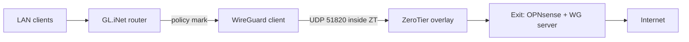
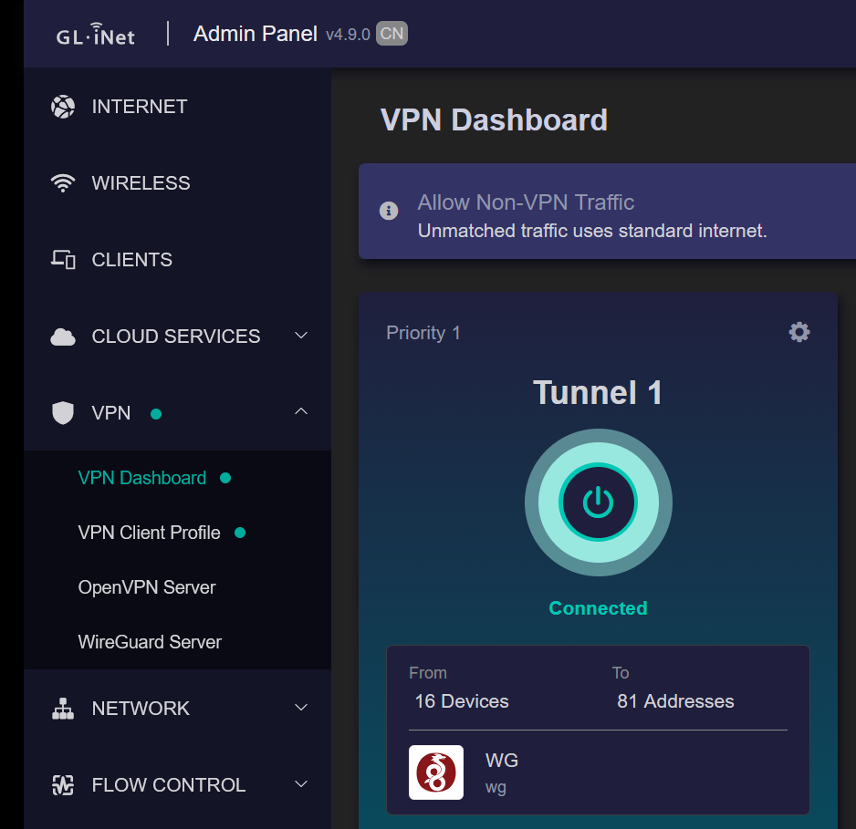
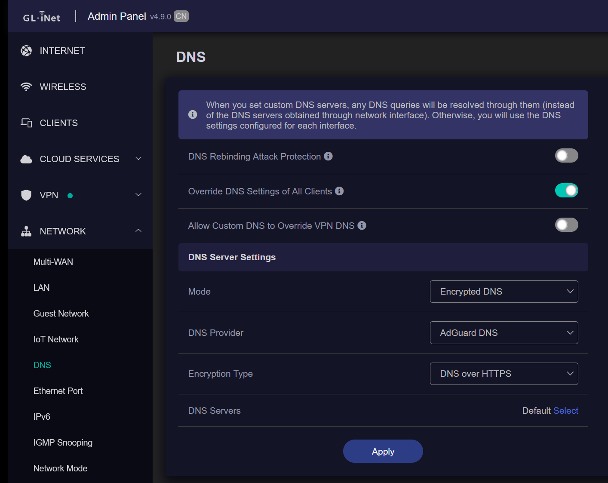
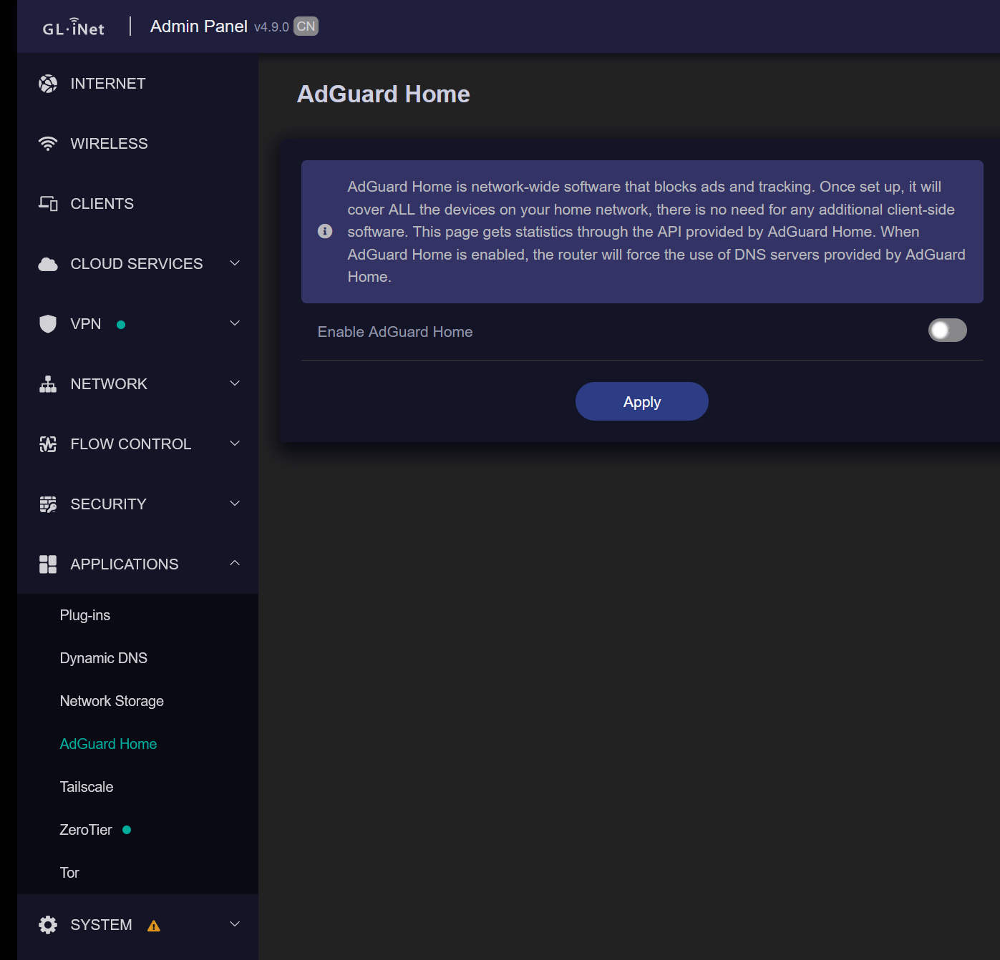
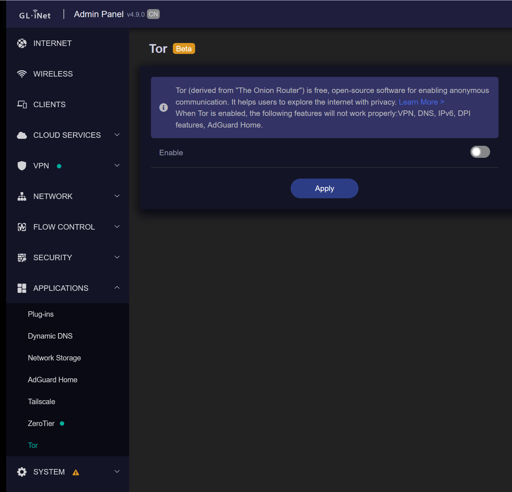

# GL.iNet China-region firmware: hidden pages, policy and WireGuard over ZeroTier

Tested on a GL.iNet router running the 4.9.0 China-region firmware (OpenWrt 23.05 base), plus a self-hosted WireGuard exit on OPNsense.

## Key facts

- The China-region firmware hides pages with a `lang_hide` property in `/usr/share/oui/menu.d/*.json`. Removing the key exposes the page. No region change, no factory reset.
- Hidden on the tested build: VPN client, VPN dashboard, OpenVPN server, WireGuard server, AdGuard Home, Tor, Dynamic DNS.
- The VPN backend needs `/tmp/run/vpn-client-booted`. Without it, an imported profile never creates its interface.
- The selective policy matches a source MAC plus a destination address. The destination set is filled by the router's DNS answers for a domain list.
- Hardware acceleration (the vendor UI toggle, ECM) must be off, or the marked forwarding does not work.
- SSH: key-only, WAN closed, ZeroTier zone open, interface list at all. Binding to the ZeroTier interface specifically broke SSH.
- WireGuard runs inside ZeroTier: the client endpoint is the exit's ZeroTier address, not its public address. A direct handshake without data is the symptom this fixes.
- The WireGuard interface needs its DNS set. Without it the tunnel handshakes and the clients' requests do not resolve.
- Tor and AdGuard Home each warn that enabling them breaks the VPN/DNS setup. Leave them off unless you are replacing that setup.

## Topology

The router and the exit are both ZeroTier members. The WireGuard endpoint is the exit's ZeroTier address. The exit's WireGuard server routes the inner traffic to the internet.

## Proof

| Page | Screenshot |
|---|---|
| VPN dashboard and server pages |  |
| Encrypted DNS settings |  |
| AdGuard Home page |  |
| Tor page |  |

The counts in the dashboard are from the test; they will differ on your equipment.

## Docs

| # | Doc | Contents |
|---|---|---|
| 01 | [Menu unlock](docs/01-the-menu-hide.md) | The `lang_hide` files, the edit, validation |
| 02 | [SSH access](docs/02-ssh-access.md) | LuCI settings, dropbear, zones, the interface-bind failure |
| 03 | [WireGuard client](docs/03-the-backend-boot-marker.md) | Backend marker, profile fields, DNS |
| 04 | [Policy, hardware, DNS](docs/04-the-policy-hardware-and-dns.md) | Marking path, domain list, acceleration, secure DNS, health check |
| 05 | [WireGuard over ZeroTier](docs/05-wireguard-over-zerotier.md) | Why, exit side, client side, MTU, pitfalls |
| 06 | [Findings](docs/06-findings-and-pitfalls.md) | What worked, failed, and remains unproven |
| 07 | [Verification](docs/07-verification.md) | Test matrix and harness |
| 08 | [Tor and other pages](docs/08-tor-and-other-hidden-pages.md) | Tor, AdGuard Home, servers, DDNS |

## Placeholders

All addresses, domains, keys and device identifiers are placeholders: `<router-lan-address>`, `<zt-address>`, `<exit-zt-address>`, `<exit-public-key>`, `<client-tunnel-address>`, `<tunnel-dns-address>`, `<preshared-key>`, `<test-domain>`, `<reachable-probe>`. The `0.0.0.0/0` and `::/0` values are the standard full-tunnel allowed-IP notation.

## Unverified

- Cause of the direct WireGuard loss: filtering or path fault. The workaround does not depend on the answer.
- Cause of the exit peer counter asymmetry.
- Whether the relayed ZeroTier path came from the version difference or the network.
- Full hostname coverage for the listed services.
- Real browser behavior versus the isolated test client.
- The hardware-offload mechanism beyond the observed behavior.
- Another self-hosted WireGuard implementation beyond OPNsense.

## Safety

Own or administer the equipment. Check the vendor terms, the provider terms and the local law. Authorize only overlay members you control. The exit operator sees the traffic. The encrypted resolver sees the queries. Keep private keys on the devices.

## License

MIT. See [LICENSE](LICENSE).
