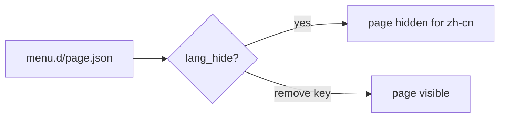

# 1. Unlock the hidden pages

## Mechanism

The vendor UI reads its menu from `/usr/share/oui/menu.d/*.json`. A page with `lang_hide` listing `zh-cn` is hidden when the UI language is Chinese. The package and the page code are installed; only the menu entry is hidden.



## Hidden pages on the tested build

| File | Page | Property |
|---|---|---|
| `vpn-client.json` | VPN client | multi-line `lang_hide` |
| `vpndashboard.json` | VPN dashboard | single-line `lang_hide` |
| `adguardhome.json` | AdGuard Home | multi-line |
| `dynamicdns.json` | Dynamic DNS | single-line |
| `ovpnserver.json` | OpenVPN server | multi-line |
| `torview.json` | Tor | multi-line |
| `wgserver.json` | WireGuard server | multi-line |

The tested build carried all seven. The VPN pair was unlocked first; the other five later, with the same method.

## Walkthrough

1. Back up the files.

```sh
backup=/etc/menu-unlock-backup-$(date -u +%Y%m%dT%H%M%SZ)
mkdir -p "$backup"
for f in vpn-client vpndashboard adguardhome dynamicdns ovpnserver torview wgserver; do
  cp -p "/usr/share/oui/menu.d/$f.json" "$backup/$f.json"
done
```

2. Remove the key. `jq` is present on the tested build and handles single-line and multi-line forms.

```sh
for f in vpn-client vpndashboard adguardhome dynamicdns ovpnserver torview wgserver; do
  jq 'del(.lang_hide)' "/usr/share/oui/menu.d/$f.json" > "/tmp/menu-$f.json"
  mv "/tmp/menu-$f.json" "/usr/share/oui/menu.d/$f.json"
done
sync
```

3. Validate.

```sh
for f in vpn-client vpndashboard adguardhome dynamicdns ovpnserver torview wgserver; do
  echo "--- $f"
  jq empty "/usr/share/oui/menu.d/$f.json" && echo "json ok" || echo "JSON INVALID"
  jq -r '.view' "/usr/share/oui/menu.d/$f.json"
done
```

4. Refresh the UI with a hard refresh or a private window. No service restart is needed.

## Verify

- The pages appear in the menu.
- `jq empty` passes for every edited file.
- The `view` value is unchanged.

## Pitfalls

- `lang_hide` is per page. Editing one file does not expose the others.
- A firmware update can restore the files.
- A browser caches the menu; a normal refresh may not show the change.
- Do not copy a menu file from a different firmware build without comparing it.
- A factory reset removes the edit.
- The page is cosmetic until the service behind it is enabled.
- `vpn-client.json` and `vpndashboard.json` are the client pages; `ovpnserver.json` and `wgserver.json` are servers.

## Related work: the country-code route

The [glinet-remove-chinalock](https://github.com/Oasis-2023/glinet-remove-chinalock) project (MIT) changes the country code in the factory partition, then requires `firstboot` and `reboot`. It is broader (VPN and AdGuard Home at the firmware level) and more invasive:

- writes the factory partition; its README warns of bricking and warranty loss
- full reset; all settings lost
- tested on other GL.iNet models, not this one
- the country code can affect a cellular modem

The menu edit above is narrower, does not touch the factory partition, and keeps the configuration. Use the country-code route only on a fresh, supported device.
