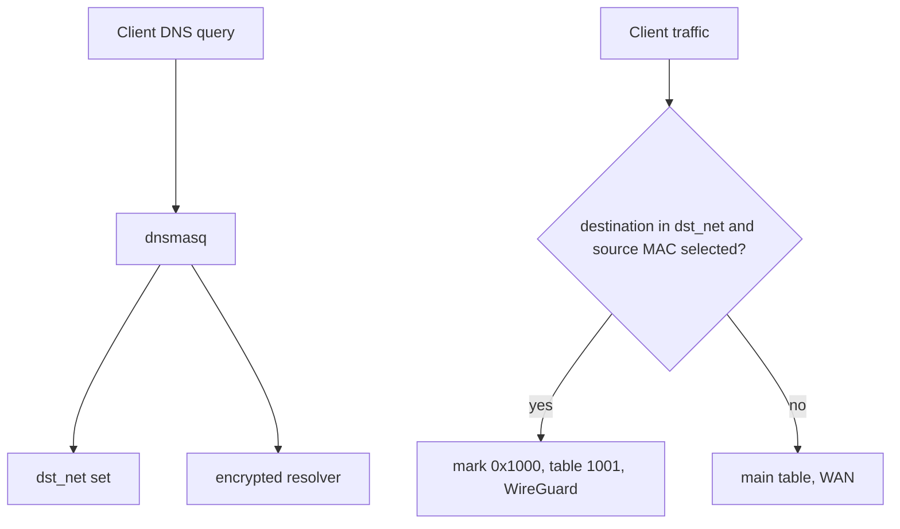

# 4. Selective policy, hardware acceleration and DNS

## Flow



## Rule and table

- Source set: `src_mac<rule-id>` (selected device MACs).
- Destination set: `dst_net<rule-id>` (filled by DNS answers).
- Mark: `0x1000`.
- Table: `1001` (the WireGuard interface).
- Domain list: `/etc/domain_mac_list/dst_net<rule-id>_manual`.
- DNS hook: `/tmp/dnsmasq.d/via_domain`.

Inspect:

```sh
uci show route_policy
nft list table inet vpn_table
ip rule
ip route show table <vpn-table>
cat /tmp/dnsmasq.d/via_domain | wc -l
```

## Domain list

- The list is names, not routes.
- The router's DNS answers fill the destination set; a client using another resolver never fills it.
- Subdomains of a listed name match; other hostnames the service loads (CDNs, APIs, sign-in) do not.
- The tested list had 81 entries. The dashboard's address count is the set size, not the list size.

Test a name:

```sh
nslookup <test-domain> <router-lan-address>
nft list set inet vpn_table dst_net<rule-id>
```

The set grows if the name is listed and the query went through dnsmasq.

## Hardware acceleration

The marked forwarding did not work with hardware acceleration on. Turning it off in the vendor UI fixed it.

```sh
uci show ecm
```

```text
ecm.global.acceleration_engine='auto'
ecm.global.enabled='0'
```

```sh
nft list ruleset | grep -c flowtable
```

```text
0
```

- The vendor UI toggle and the ECM entry describe the same state.
- Likely cause: the offload path bypasses the nftables marks and the policy route. Not instrumented.
- Turn acceleration off before debugging the rule.

## Secure DNS

The vendor DNS page was used, not a hand-written dnsmasq config.

- Mode: secure, encrypted upstream (DoH or DoT).
- `force_dns` on.
- Local dnsproxy is the encrypted resolver.
- dnsmasq: `no-resolv`, `server=<local-resolver-address>#<local-resolver-port>`.
- LAN port 53 redirected to the router's resolver.
- Policy-marked clients' DNS redirected to a separate resolver port.

```sh
uci show gl-dns-v2
```

```text
gl-dns-v2.@dns[0].mode='secure'
gl-dns-v2.@dns[0].proto='doh'
gl-dns-v2.@dns[0].provider='<provider>'
gl-dns-v2.@dns[0].force_dns='1'
gl-dns-v2.@dns[0].servers_list='Default'
gl-dns-v2.@dns[0].proxy_list='<bootstrap-resolver>#53'
```

```sh
nft list table inet dns_table
```

```text
chain dns_redirect { meta l4proto { tcp, udp } redirect to :53 }
chain policy_redirect { meta l4proto udp meta mark & 0x0000f000 == 0x00001000 redirect to :2153 }
chain dns_dispatcher { jump policy_redirect; jump dns_redirect }
chain PREROUTING {
    iifname "<lan-bridge>" tcp dport 53 jump dns_dispatcher
    iifname "<lan-bridge>" udp dport 53 jump dns_dispatcher
}
```

- A client using its own DoH/DoT bypasses both redirects (port 53 only).
- `override_vpn` and the redirect port are build-specific; check your build.

## Tunnel DNS

The WireGuard interface needs the exit's resolver addresses. Without them the tunnel handshook and the clients' requests did not resolve. With them, `dnsmasq` used those addresses for the tunnel resolver.

Set the same value in the profile's `DNS` line and the vendor UI's DNS field.

## Health check

The vendor internet check probes `glconfig.general.track_ip`. Unreachable targets make the UI report no internet while data works.

```sh
uci show glconfig.general.track_ip
uci set glconfig.general.track_ip='<reachable-probe> <reachable-probe>'
uci commit glconfig
```

Re-evaluated on the next cycle or after a reboot.

## Verify

- `route_policy` rule enabled, global policy on.
- `nft` source and destination sets present.
- `ip rule` and table 1001 route to the WireGuard interface.
- One `nftset` line per listed name.
- A lookup of a listed name grows the destination set.
- A selected client to a listed address carries the mark.
- A selected client to an unlisted address stays on the WAN.

## Pitfalls

- The list is not a route; the set must be populated by DNS.
- Subdomains match; other service hostnames do not.
- Client-side secure DNS bypasses the marking.
- MAC rotation or a client behind another router does not match the source set.
- The router's own traffic and unselected clients do not match.
- An empty set means nothing to match.
- Killswitch/global policy changes unmatched behavior.
- Hardware acceleration hides the policy path.
- The health check and the data path are separate.
- A firmware update can rewrite the rule, sets or DNS.
- The AdGuard Home page (08) is a different feature from the vendor DNS page.
