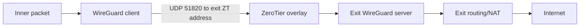

# 5. WireGuard over ZeroTier

## Why

Direct WireGuard to the exit's public address handshook but carried no data. The endpoint hostname could also resolve to a filtered or changing address. Running the same WireGuard tunnel inside ZeroTier made the endpoint an overlay address the client controls.

The exit must be a self-hosted WireGuard server that is already a ZeroTier member. The tested exit is OPNsense.

## Encapsulation



- The WireGuard endpoint is `<exit-zt-address>:51820`.
- ZeroTier carries the WireGuard UDP over its own transport, direct or relayed.
- The exit decapsulates and routes the inner traffic.
- Two encapsulation layers: budget the MTU. Start at 1420.

## Exit side (tested on OPNsense)

1. Join the same ZeroTier network; authorize the client.
2. Create a WireGuard instance: listen port 51820, tunnel address in the WG subnet, enabled.
3. Add a peer: client public key, preshared key, allowed IP `<client-tunnel-address>/32`.
4. Firewall: allow UDP 51820 from the ZeroTier subnet to the exit's ZeroTier address.
5. Firewall: allow the client's tunnel address on the WireGuard interface.
6. Routing/NAT: route the WG subnet to the internet; NAT for a full tunnel.
7. Check: `wg show` on the exit shows the client peer and a recent handshake.

The OPNsense UI paths: WireGuard instance/peer pages under VPN → WireGuard; ZeroTier under the ZeroTier plugin.

Another self-hosted WireGuard server uses the same pieces; the UI and firewall labels differ.

## Client side

| Item | Value |
|---|---|
| Endpoint | `<exit-zt-address>:51820` |
| Address | `<client-tunnel-address>/32` |
| DNS | `<tunnel-dns-address>` or the exit's resolvers |
| AllowedIPs | `0.0.0.0/0`, `::/0` or a split |
| Keepalive | 15 |
| MTU | 1420 |
| ZeroTier zone | input ACCEPT for management |
| WireGuard zone | input DROP |

The client's DNS is required. Without it the tunnel handshakes and the clients' requests do not resolve.

## ZeroTier network

- Both members authorized.
- No flow rules needed for a private network; if rules exist, allow the WireGuard port between the two members.
- Managed routes are not required for the tunnel; WireGuard carries the inner addresses.

## Verify

Client:

```sh
wg show
ping -c 3 <exit-zt-address>
curl --interface <wg-interface> https://<test-domain>/
```

Exit:

```sh
wg show
```

- Handshake recent on both sides.
- The request returns the exit's public address.
- Transfer counters grow once data passes.

## Pitfalls

- The exit must be self-hosted and already on ZeroTier.
- ZeroTier must be up before the WireGuard endpoint is reachable.
- The endpoint must be the exit's ZeroTier address, not its public address.
- A handshake is not data; test a request.
- Exit firewall: allow the WireGuard port on the ZeroTier interface, not only the WAN.
- Client ZeroTier zone: allow input for management; the WireGuard zone can drop input.
- MTU: both layers cost overhead; large packets can stall while small requests work.
- Relayed paths work but add latency; direct can return later.
- Version mismatch between members can coincide with a relayed path; not proven.
- A reauthorized ZeroTier member can change address; update the endpoint.
- Peer counters can be asymmetric; a hint, not proof.
- The DNS is part of the working tunnel.
- A reboot can bring the overlay up after WireGuard; check the retry.
- The exit's UI and firewall labels are implementation-specific.
