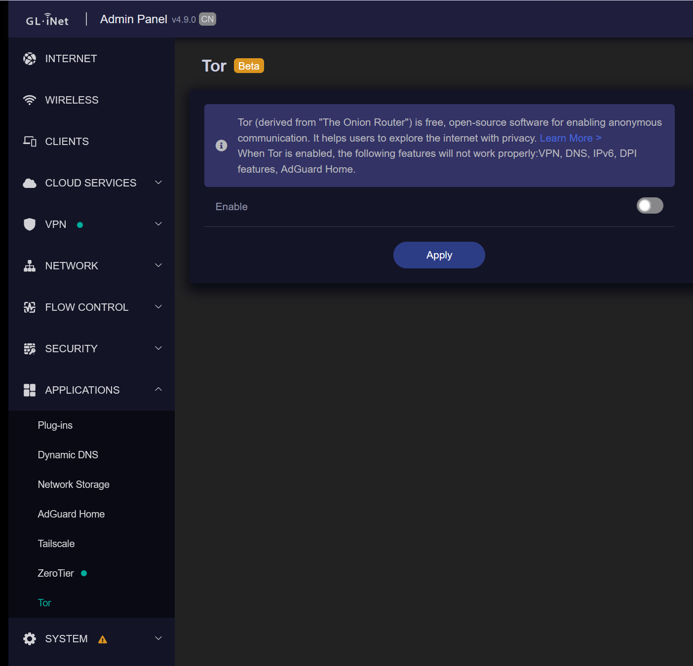
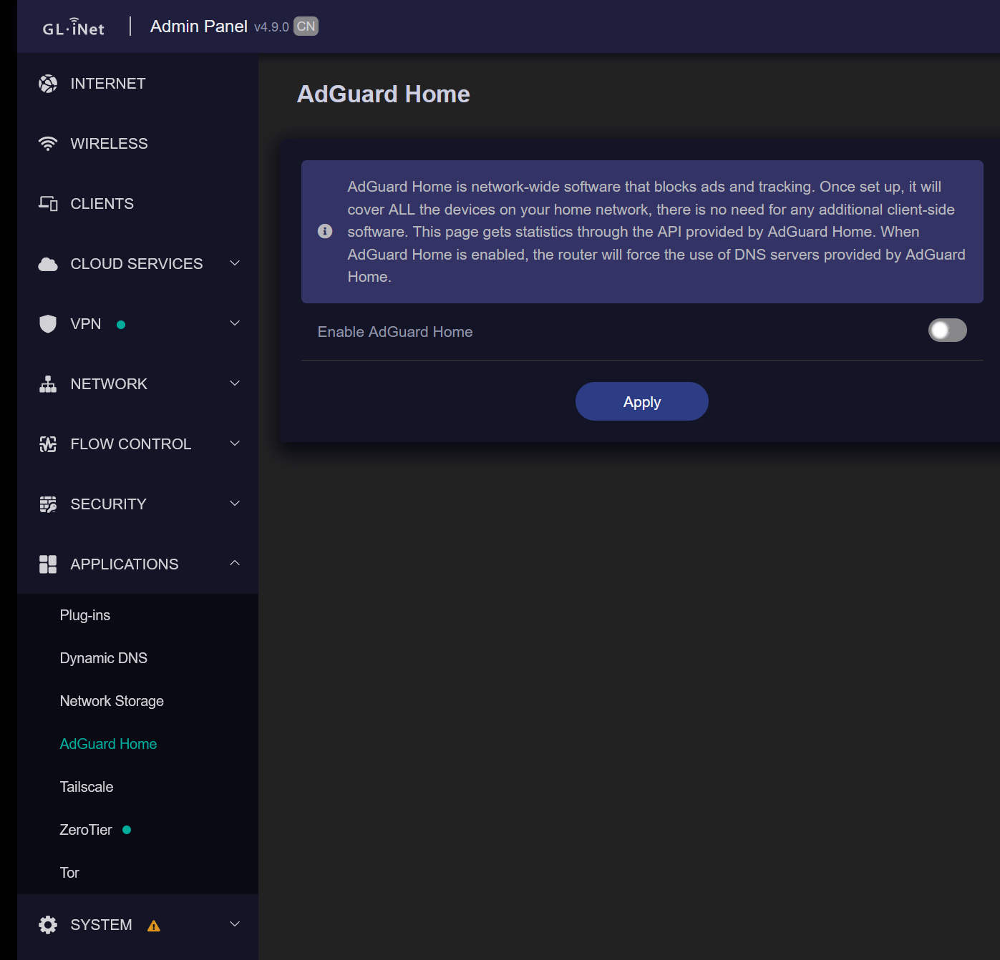

# 8. Tor and the other hidden pages

## Pages

| File | Page | Notes |
|---|---|---|
| `torview.json` | Tor | package installed, service off |
| `adguardhome.json` | AdGuard Home | forces DNS to AdGuard Home when enabled |
| `ovpnserver.json` | OpenVPN server | server, not client |
| `wgserver.json` | WireGuard server | server, not client |
| `dynamicdns.json` | Dynamic DNS | |

All use the same `lang_hide` edit as 01.

## Tor

- Page: Applications → Tor (Beta).
- Packages: `gl-sdk4-tor`, `gl-sdk4-ui-torview`, `tor`, `tor-geoip`.
- Service: `/etc/init.d/tor`.
- Config: `tor.global.enable='0'`, `manual='0'`, `countries='all'`.
- The page is visible after the edit; the service stays off until enabled.

The page's own warning:

> When Tor is enabled, the following features will not work properly: VPN, DNS, IPv6, DPI features, AdGuard Home.

So Tor conflicts with the tunnel and DNS setup in this repo. Leave it off unless you are deliberately replacing that setup.

## AdGuard Home

- Page: Applications → AdGuard Home.
- Enabling it forces the router's DNS to AdGuard Home's servers.

That replaces the vendor DNS chain in 04. It is an either/or choice, not an addition.

## Verify

- Page visible after a hard refresh.
- `jq -r '.view'` returns the expected view for each file.
- The services remain off until enabled: `uci -q get tor.global.enable` returns `0`.

## Pitfalls

- `lang_hide` is per page; editing one file does not expose the others.
- A firmware update can restore the menu files.
- The page is not the service; enabling is separate.
- Tor is not a private VPN; exits are public by design.
- Tor disables the VPN, DNS, IPv6, DPI and AdGuard Home while enabled.
- AdGuard Home overrides the vendor DNS resolver.
- The OpenVPN/WireGuard pages here are servers; the client is 01/03.
- Unlocking a page does not install a missing package.
